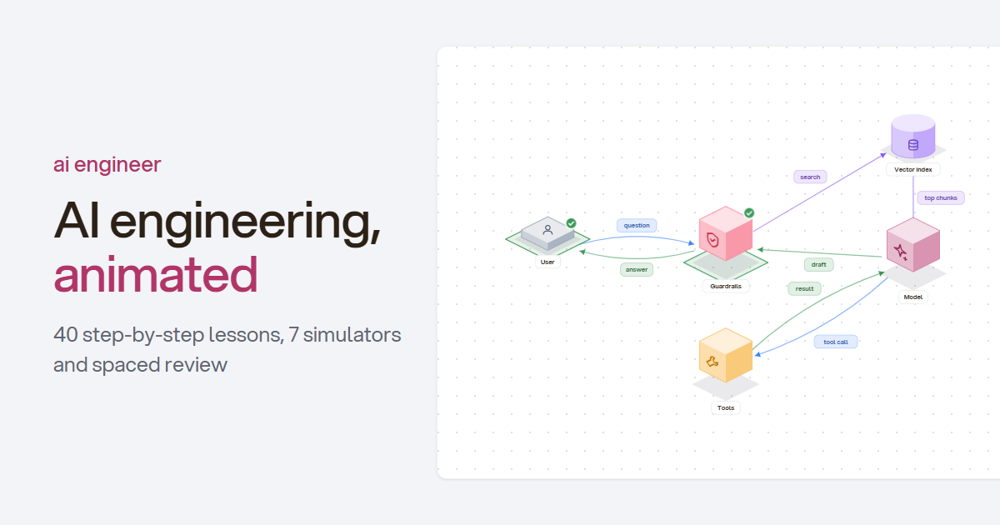

# AI Engineer Course

**Learn AI engineering by watching it happen.** An open-source, interactive course: 40 animated lessons,
7 hands-on simulators, quizzes and spaced review, covering LLMs, RAG, agents, evals, system design, security
and deployment.

Made by **louAI**. Free and open source under the [MIT License](LICENSE).



## What makes it different

- **Every lesson is a diagram you step through.** Requests travel between components as labelled packets.
  A block's result appears only when the packet that causes it arrives, so you see cause and effect.
- **The numbers move.** Each step updates latency, cost, accuracy or risk, and shows the old value beside the new.
- **You play with it.** One simulator per area: sampling, chunking, agent reliability, judge calibration,
  model routing, prompt-injection defence and canary releases.
- **It stays with you.** Each lesson ends with two scenario questions. Answers feed a spaced-review queue
  (1, 3, 7, 16 and 35 days).
- **Hands-free when you want.** Auto mode plays a whole lesson at reading speed. Moving the mouse over a
  finished diagram replays it.

No account, no cookies, no server: progress stays in your browser. Visits are counted with cookieless [Cloudflare Web Analytics](https://www.cloudflare.com/web-analytics/) (no personal data); build with `CF_BEACON_TOKEN=""` to turn it off.

## Course map

| # | Area | Lessons |
| --- | --- | --- |
| 01 | LLM | Tokenization, Self-Attention, Context Windows, Temperature & Top-p, Reasoning Models, Structured Outputs, Prompt Caching |
| 02 | RAG | Embeddings, Chunking Strategies, Vector Databases, Hybrid Search, Reranking, Contextual Retrieval, Agentic RAG |
| 03 | AI Agents | Tool Calling, The Agent Loop, Long-term Memory, Orchestrator–Worker, MCP, A2A Protocol, Human-in-the-loop |
| 04 | AI Evals | Golden Datasets, LLM-as-a-Judge, Faithfulness, Trajectory Evals, Tracing |
| 05 | AI System Design | Model Routing, Model Fallbacks, Semantic Caching, Streaming Responses, Context Management |
| 06 | AI Security | Prompt Injection, Indirect Injection, Input Guardrails, PII Redaction, Least-privilege Tools |
| 07 | Deployment | Docker, Eval Gates in CI, Canary Releases, Prompt Versioning |

Another 100 concepts are on the roadmap and listed in the app as "coming soon".

## Run it locally

Needs Node 22.13 or newer and pnpm 10.

```sh
pnpm install
pnpm dev
```

Open http://localhost:3000.

| Command | What it does |
| --- | --- |
| `pnpm dev` | Development server with hot reload |
| `pnpm check` | Everything CI runs: lint, types, tests and build |
| `pnpm test` | Unit tests, including checks on every lesson's content and layout |
| `pnpm build` | Static site in `out/`, with a Content-Security-Policy on each page |
| `pnpm preview` | Serves `out/` locally |

## How it works

Built with Next.js 16 (static export), React 19 and TypeScript. There is no backend.

| Folder | Contents |
| --- | --- |
| `src/app` | Routes, metadata, sitemap and the social image |
| `src/components/stage` | The animated isometric diagram |
| `src/components/lesson` | The lesson player: step rail, player bar, guide text |
| `src/components/labs` | One file per simulator |
| `src/components/practice` | Quiz and spaced review |
| `src/components/dashboard`, `layout`, `ui` | Home page, app shell, small shared pieces |
| `src/content` | Lessons, quizzes and the course map, all as typed data |
| `src/lib` | Hooks and logic without markup: the animation clock, progress, metrics |
| `src/styles` | One stylesheet per area; colours live in `tokens.css` |
| `scripts` | Post-build step: portable file names and per-page script hashes |
| `tests` | Vitest |

The animation is driven by one clock per diagram (`src/lib/useTimeline.ts`). Frames update the moving packet
directly, and React re-renders only when a packet leaves or lands. It respects `prefers-reduced-motion`, and the
dashboard diagram pauses when it is off screen.

## Deploy

The build is plain files. Set `SITE_URL` (for example `https://example.com`) at build time, so the sitemap and
social links use the right address.

- **Cloudflare Workers** (configured in `wrangler.jsonc`): connect the repository under Workers & Pages, with
  build command `pnpm build`, deploy command `npx wrangler deploy`, and the build variable `SITE_URL`.
- **Any static host:** upload `out/`, and set the response headers listed in `public/_headers`.

## Contributing

Contributions are welcome, especially new lessons from the roadmap. Read [CONTRIBUTING.md](CONTRIBUTING.md),
and [src/content/AUTHORING.md](src/content/AUTHORING.md) before writing a lesson. To report a vulnerability, see
[SECURITY.md](SECURITY.md).

## License

Code and course content: [MIT](LICENSE), © 2026 louAI.

The font is [Aspekta](https://github.com/ivodolenc/aspekta) by Ivo Dolenc, under the SIL Open Font License 1.1
([src/fonts/OFL.txt](src/fonts/OFL.txt)). Icons are from [Lucide](https://lucide.dev) (ISC License).
